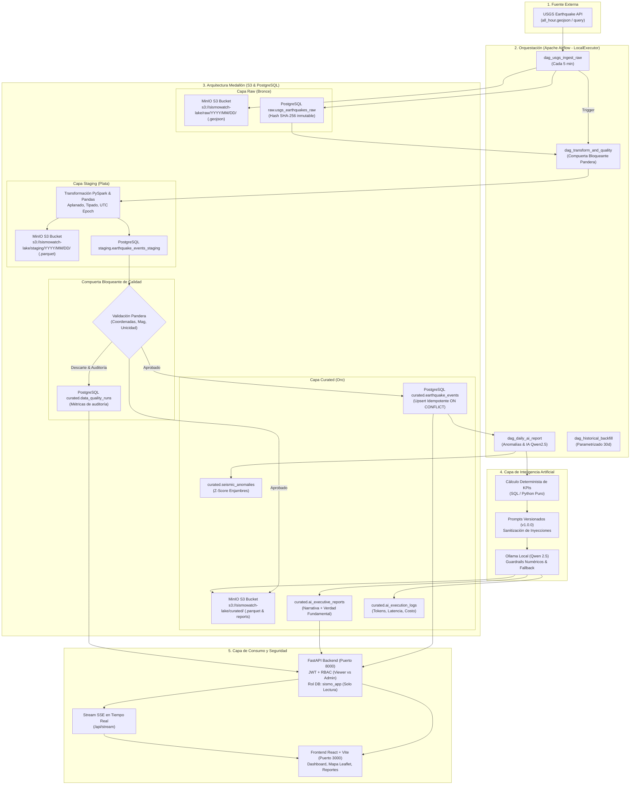
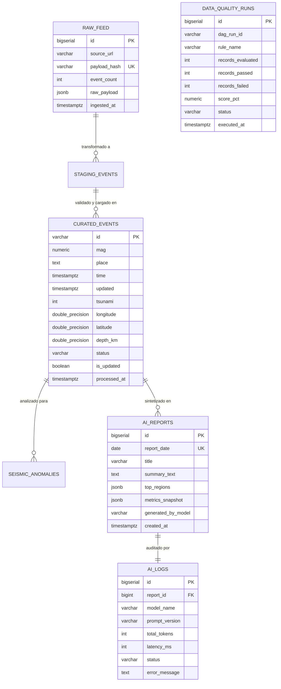

# Documento de Arquitectura de Datos — SismoWatch

## 1. Propósito de la Arquitectura

### 1.1 El Problema que Resuelve
El Servicio Geológico de Estados Unidos (USGS) proporciona un catálogo sísmico público accesible vía HTTP en formato GeoJSON (`all_hour.geojson`). Sin embargo, este feed presenta serias limitaciones operativas:
- **Volatilidad extrema y falta de retención histórica:** El feed de última hora cambia cada minuto y no almacena historial navegable ni enriquecido.
- **Sin validación de integridad ni consistencia:** La fuente externa puede contener coordenadas erróneas, registros duplicados tras revisiones técnicas de sensores o magnitudes preliminares no revisadas.
- **Sin síntesis ni analítica automatizada:** Los equipos de gestión de riesgo no disponen de un resumen ejecutivo en tiempo real que interprete los eventos y filtre el ruido instrumental.
- **Ausencia de acceso gobernado:** Sin una plataforma dedicada, no existía separación entre roles de auditoría y operaciones, ni garantías de seguridad ante posibles accesos no autorizados.

### 1.2 ¿Para quién se diseñó?
1. **Equipos de Operaciones de Emergencia:** Requieren conocimiento situacional inmediato ("¿dónde, cuándo y de qué magnitud?") para priorizar alertas y despachos en minutos.
2. **Equipos de Gestión de Riesgo y Analítica:** Demandan consultas sobre series temporales, detección de enjambres sísmicos, reportes ejecutivos confiables para comités y exportación formal de informes auditados.
3. **Auditores de Calidad de Datos:** Necesitan comprobar que ningún dato erróneo o corrupto sea consumido por la organización y supervisar qué registros fueron descartados a cuarentena.

### 1.3 Decisiones que Habilita
- **Priorización de Alertas Críticas:** Detección instantánea de sismos mayores (M $\ge$ 6.0) y activación de protocolos preventivos ante alertas de tsunami (`tsunami = 1`).
- **Respuesta Preventiva ante Enjambres:** Identificación estadística de anomalías (Z-Score $\ge 2.0$) que permite anticipar colapsos estructurales en fallas activas.
- **Gobernanza de Calidad en Tiempo Real:** Garantía de que el 100% de los datos consumidos en dashboards cumplen los rangos físicos y geográficos válidos.

---

## 2. Diagrama de Componentes y Capas

---

## 3. Capas de la Arquitectura Medallón

| Capa | Almacenamiento Lakehouse | Propósito | Reglas de Idempotencia |
|---|---|---|---|
| **Raw (Bronce)** | MinIO S3 (`.geojson`) y `raw.usgs_earthquakes_raw` (JSONB) | Preservar el dato exacto tal como fue entregado por la USGS. Permite re-procesamiento completo ante cambios en la lógica de negocio. | `payload_hash` SHA-256 con restricción `UNIQUE`. Solicitudes duplicadas se omiten transparentemente (`ON CONFLICT DO NOTHING`). |
| **Staging (Plata)** | MinIO S3 (`.parquet`) y `staging.earthquake_events_staging` | Aplanar la jerarquía GeoJSON (`properties` y `geometry.coordinates`), parsear milisegundos epoch a `TIMESTAMPTZ` con zona horaria UTC y tipificar numéricamente las columnas en formato columnar Parquet y relacional. | Extracción y deduplicación con PySpark/Pandas basada en clave primaria natural `id`. |
| **Curated (Oro)** | MinIO S3 (`.parquet` y reportes `.json`) y `curated.earthquake_events` | Publicar únicamente datos que superaron la compuerta de calidad para consumo analítico, reportes narrativos y operacional. | `ON CONFLICT (id) DO UPDATE SET ...` para soportar actualizaciones de eventos recalculados por USGS sin duplicar registros. |

---

## 4. Modelo de Datos y Diccionario de Esquemas

### 4.1 Diagrama Entidad-Relación

---

## 5. Justificación de Decisiones Técnicas y Trade-offs

### 5.1 ¿Por qué Apache Airflow y no un Cron Job?
- **Trazabilidad y Observabilidad:** Un cron job tradicional no ofrece interfaz visual del estado de los DAGs, métricas de ejecución, visualización de árboles de dependencia ni reintentos automáticos configurables con retroceso exponencial.
- **Gestión de Dependencias y Linaje:** Airflow coordina la secuencia de ingesta $\rightarrow$ transformación $\rightarrow$ calidad $\rightarrow$ IA de forma declarativa mediante operadores y disparadores (`TriggerDagRunOperator`).
- **Backfill Parametrizado:** Permite ejecuciones históricas parametrizadas sin alterar la programación regular de producción.
- **Alertas Integradas:** Manejo centralizado de fallos mediante callbacks (`on_failure_callback`).

### 5.2 ¿Por qué Pandera para la Calidad de Datos?
- **Rendimiento y Ligereza:** A diferencia de Great Expectations, que impone una sobrecarga considerable en tiempo de inicialización y almacenamiento de artefactos pesados en disco, Pandera se ejecuta de forma nativa en memoria sobre DataFrames.
- **Detalle Fila a Fila:** Permite identificar exactamente qué registro incumplió una regla (ej. Latitud $= 150.0$) para bifurcarlo a la tabla de cuarentena sin interrumpir la carga de los registros sanos.
- **Tipado Fuerte y Compatibilidad:** Integración transparente con Python 3.11+, Pandas y PySpark.

### 5.3 ¿Por qué Qwen 2.5 en Ollama y Guardrails Deterministas?
- **Soberanía y Costo Cero:** Qwen 2.5 local vía Ollama no expone datos sísmicos a nubes públicas ni genera costos por token de API.
- **Principio Anti-Alucinación:** El LLM **nunca realiza cálculos matemáticos**. Los valores (conteos, máximos, medias, porcentajes) son computados determinísticamente en SQL/Python e inyectados en el prompt. Una función de validación regex verifica que el texto redactado contenga las cifras calculadas; en caso de anomalía, un fallback determinista garantiza la continuidad del servicio.

### 5.4 ¿Por qué Server-Sent Events (SSE) y no WebSockets?
- **Unidireccionalidad:** Los eventos sísmicos fluyen del servidor al cliente. SSE es un protocolo HTTP nativo unidireccional que no requiere el overhead de negociación bidireccional de WebSockets.
- **Reconexión Automática:** La API nativa del navegador (`EventSource`) implementa reconexión automática transparente en caso de caída temporal de la red.
- **Compatibilidad con Proxies:** Funciona de forma estándar sobre HTTP/1.1 y HTTP/2 a través de Nginx sin configuraciones complejas de handshake de sockets.

---

## 6. ¿Qué haríamos diferente en Producción a Gran Escala?
1. **Airflow Executor:** Migrar de `LocalExecutor` a `KubernetesExecutor` o `CeleryExecutor` con workers distribuidos y autoescalado horizontal según carga.
2. **Data Lakehouse:** Implementar tablas Apache Iceberg o Delta Lake sobre S3 (AWS S3 con KMS) para soportar *Time Travel* analítico y transacciones ACID nativas a escala de petabytes.
3. **Base de Datos Distribuida:** Utilizar Citus Data o AWS Aurora PostgreSQL multi-AZ con réplicas de lectura dedicadas para la API de consumo.
4. **Secret Management:** Reemplazar el archivo `.env` por HashiCorp Vault o AWS Secrets Manager con rotación automática de claves Fernet y credenciales de base de datos.
